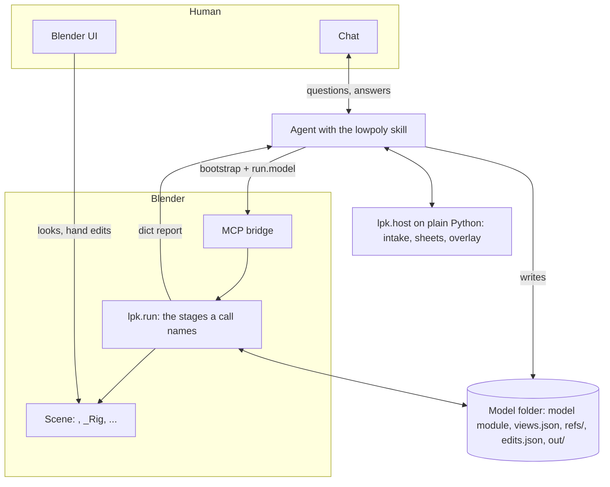

# lowpoly-kit: LLM-assisted low-poly modelling in Blender

> **Work in progress.** Made for the author's own projects; most of the code and docs were written with
> LLM agents. Interfaces still change. Biped characters, quadrupeds, props without a rig and rigid mechanisms for now.

An LLM agent drives Blender through MCP and does the repetitive modelling; you give the brief, direct the
look, check each step in Blender and accept the result. The kit gives the agent forms, texturing, rigging,
review tools and export. It does not make the agent see or judge better: you steer the checks.

## Setup

You need:

- Blender 5.1 or newer, with a Blender MCP bridge, Cycles enabled and a 3D Viewport open
- plain Python with numpy and Pillow: picture intake, contact sheets and overlays run outside Blender
- optionally the Voxel Heat Diffuse Skinning add-on; without it the agent uses another weights backend

Then:

1. Clone the kit.
2. Give your agent the kit's folder and point it at [skills/lowpoly/SKILL.md](skills/lowpoly/SKILL.md).
3. Ask it to run the setup check first: it lists what is missing and how to fix it.

## A session, step by step

| Step | You give or do | The agent | You check |
|---|---|---|---|
| Brief | references or a description; height; triangle and atlas budget; skeleton; read size (how tall it stands on screen); whether references may go to an image tool | asks for everything missing in one message | – |
| Intake | a cleaned sheet, if asked | cuts, calibrates and measures the views | – |
| Blockout | – | a figure of blocks, `<Name>_Blocks`, beside the drawings | proportions |
| Build, part by part | corrections (move vertices; see [the two modes](#parametric-and-frozen)) | head, hair, torso and clothing, legs, arms, hands, tail, gear; over the triangle budget, an optimisation pass once all parts stand | each part against the drawing; any cut that changes how a part reads |
| Texture | – | the colour atlas with the painted face | the atlas on the model |
| Rig (a character) | – | skeleton, weights, test poses | no tearing, limbs bend at the joints |
| Export, when you ask for it | the targets, then the import check in your engine | the files, re-imported and compared | the file in the engine |

The agent stops and asks at each check; nothing in the kit waits for your answer on its own. The model is
finished in the `.blend` without the export: ask for the export when you need the files, now or once all
your models are ready. A prop (a
barrel, a crate, a lamp) takes the same steps without the rig: give its pivot (the base, a grip, a hook)
in the brief.

## References

Give:

- a **front and a side** of the full figure, on one ground line
- the **final look** (clothed, with gear), hands and feet in frame
- a **head close-up** for a snout, a beak, a mane or a helmet
- a **back view** when the back differs
- the **height**, when nothing in the pictures shows the scale

A three-quarter view gives heights only: its outline mixes width and depth.

**Cluttered sheet** (overlapping views, labels on the figure, sketch lines). The agent tries, in order:

1. asking you for a cleaned copy: usually the fastest
2. an image tool, if there is one and you allowed it (asked once per model)
3. the kit's own `clean`, which removes small marks and lists each one

Every cleaned copy is compared with the original (`compare`): a copy that changed the figure counts as a
generated view.

**Missing view.** With your permission an image tool can draw it. Your original concept wins wherever the
two disagree, and the agent tells you which measurements come from the generated view.

**No references.** Describe the model: the agent takes every size from your brief, and you judge each
step by eye.

## Parametric and frozen

| | Parametric | Frozen |
|---|---|---|
| The model is | rebuilt from recipes driven by measured numbers | a finished mesh kept in the `.blend` |
| You may | move vertices: every rebuild replays your moves | any edit: add, delete, cut, merge, retopologise |
| You may not | change the topology: the kit refuses to rebuild over it | – |
| Starts | from the blockout, always | when you ask to freeze, or from a finished model you bring |

- **Freeze** when the mesh needs a change the recipes cannot make. Freezing is one way: going back to
  parametric discards every edit since.
- **While frozen** the agent works by part: it summarises each part, captures one alone, selects one for
  you, moves faces you select into another part or colour, and moves, scales, replaces, decimates,
  subdivides or smooths a whole part.
- **Save the `.blend`**: the frozen mesh lives only there.

## Texture

One texture per model, the colour atlas, in two layers:

- **Base colours.** Each face carries one palette colour, baked flat. Ask for grain and the agent sets a
  grit colour (`GRIT`).
- **Painted details** (eyes, mouth, trouser line, markings). Hidden helper geometry just off the body,
  baked into the atlas and never exported.

Good to know:

- Painted details look ragged in captures until the bake: judge them on the baked atlas.
- The atlas is made again on every bake, so a change of the model shows at once.
- In the frozen mode painted details follow the reshaped surface.

### Painting the atlas by hand: frozen texture

Once the model is frozen you can freeze the texture too:

- **You may** paint the atlas in Blender and move UVs: the agent never remakes them.
- **The agent only** adds new painted layers on top; no other pixel changes.
- **Mesh edits stay allowed.** After an edit the agent lists the faces left without usable UVs and, on your
  word, gives them new UVs and bakes them. Your painting does not run into them: repaint them.
- **Unfreezing** is your call and discards the hand painting. So does a repair the atlas has no room for:
  the agent asks first.
- A finished model you bring with one UV map and one image keeps its texture, frozen.
- **Save the `.blend`**: the frozen atlas lives only there.

## Asking for a check

The tools measure and report; the agent decides which to run, and judging a capture by eye can miss a
shape that is off. When you see a mismatch, or doubt one, ask for the measurement:

| You see | Ask for |
|---|---|
| A part's shape or size differs from the drawing | the overlay of the build on that view |
| The proportions look off overall | the outline comparison, and the captures beside the references |
| A small part is hard to judge (a hand, an ear) | a capture of that part alone |
| The two sides differ | the mirror report |
| A limb looks glued on or sunk in | the limb separation and armhole reports |
| The body shows through hair or clothing | the shell clearance |
| A joint tears or folds when posed | the pose sheet and the join metrics |
| The engine's own animations may not fit the rig | the clip sheet: a clip of yours on the rig, frame by frame |
| Thin painted lines break up, the face looks blurry | the texel readings, then a texel boost for the part |
| Detail reads poorly at play distance | the read-size captures |
| The file differs in the engine | the export's re-import comparison |
| After a frozen edit a part looks wrong or a colour moved | the zone summary, then select and reassign |

Name the part and the view, ask to see the numbers and the picture, and ask for the model's numbers to
change rather than a patch on the mesh.

## New forms: local and shared

When a part needs a form the kit lacks (a long beard, a shoulder pad), the agent writes it in your
**local library**:

- **Where:** `lpk_local/forms/<model>/` in the kit's folder, `<model>` being the model file's name. Give
  each model file its own name, a Python identifier (`hero_knight`, not `2-knight`).
- **One package per character.** A form another character has is copied, never imported: work on one
  character never changes another.
- **Yours alone:** git ignores it. Carry it over when you replace the kit: your characters do not build
  without it.

The **shared library** (`lpk/forms/`) is the kit's own, documented and tested:

- When several characters hold similar forms, the agent proposes one shared form; it never moves one on
  its own.
- On your word it merges them into `lpk/forms/` with docs, a test and a catalogue line; the characters you
  name switch to it and drop their local copies.
- The move changes your copy of the kit; getting it into the kit's repository is the maintainer's review.

## What you get and what to keep

- The requested files in the output folder, and a short message with their paths and anything blocking.
- Keep, to change the model later:
  - its folder: the model file, `views.json`, the references, your edits
  - its forms: `lpk_local/forms/<model>/`
  - in the frozen mode, its `.blend`

## For agents

Start with [skills/lowpoly/SKILL.md](skills/lowpoly/SKILL.md) and the worked examples
`examples/mannequin/mannequin.py` (a character), `examples/trooper/trooper.py` (a light character on the
light rig), `examples/hound/hound.py` (a quadruped), `examples/barrel/barrel.py` (a prop) and `examples/turret/turret.py`
(a rigid mechanism); the structure is
in [ARCHITECTURE.md](ARCHITECTURE.md).

## Repository

| Folder | Holds |
|---|---|
| `lpk/` | the runner, the builder and shape operations, forms by body area, texture, rig, export, review tools, intake, skeleton templates and export profiles |
| `skills/lowpoly/` | the workflow the agent follows and the technique cards |
| `examples/mannequin/`, `examples/trooper/`, `examples/hound/`, `examples/barrel/`, `examples/turret/` | the worked examples, a character, a light character, a quadruped, a prop and a rigid mechanism: one model module each, with its views and references when it has them |
| `lpk_local/` | your local form library, one package per model, created on first use and ignored by git |
| `dev/`, `tests/`, `lpk_dev/` | development tools, host tests and fingerprints ([contribution rules](CONTRIBUTING.md)) |

