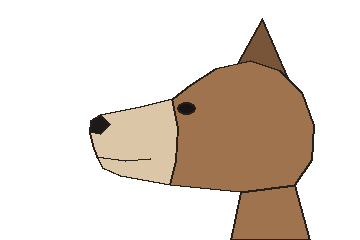
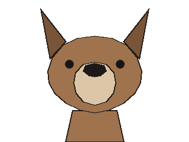

# Worked example: snout_head keys traced off a drawn head

This example takes one drawn animal head from its two views to `head.snout_head` keys in metres, checks
what the keys make in the front view before anything is built, and corrects them once. Every number
below belongs to this drawing: the columns, the exponents, the lower half widths and the readings are
this head's, not defaults, and another head reads its own. When to take this route is in the
[head card](head.md#measure-the-keys); the kit's `tests/test_snout_keys.py` runs the code below on the
drawing and holds the readings to the ones shown.

## The drawing

[`snout-keys/draw.py`](snout-keys/draw.py) draws a generic muzzled animal head, a side view and a front
view in flat colours with dark ink, and writes the `views.json` a model would hold for them:

| Side (`side.png`) | Front (`front.png`) |
|---|---|
|  |  |

- **Calibration.** The head belongs to a figure 1.2 m tall whose crown is on row 60 and whose soles are
  below the pictures; the front view is calibrated by those rows (`rows`), and the side view takes the
  front's rows (`rows_of`). One pixel is one millimetre in both.
- **The side view** faces left, model y = 0 on column 300 (`zero_px`), so a column further left lies
  further forward.
- **Traces.** `head_side` is the head's side outline, `head_front` the head's front outline alone: the
  ears and the neck stay outside both, since their width is not the head's. `muzzle_front` is the
  muzzle's own outline in the front view, which lies inside the face.

## The keys

The columns sit at the side outline's turning points, back to front: the back of the skull, behind the
crown, the crown, the forehead, the eye (the stop the eyes sit on), the face plane, the muzzle's root,
its middle, the nose's base and the muzzle's drawn front, just behind the nose tip. `head.traced_keys`
reads each key's top and bottom off the side outline at its column and its half width off a front
outline at the key's mid-height row:

- the cranium and face keys off `head_front`;
- the muzzle's keys off `muzzle_front`: in front of the face plane, the face hides their width in the
  head's outline;
- the back of the skull off neither: the front view hides it behind the cheeks and there is no top
  view, so its half width is a value chosen for this drawing and logged as such.

The nose apex is the drawn nose tip and the skull's apex the back of the skull, both through
`head.side_point`. The nose is blunt: its last key stands nearly full height just behind the apex.

```python
from mathutils import Vector

from lpk.forms import head

# This drawing's choices (snout-keys/views.json), not defaults; the columns as listed above.
COLUMNS = (306, 280, 250, 215, 186, 172, 150, 120, 100, 92)
STOP = 4                     # the key at the eye's column
SIDES = 10                   # snout_head's n
BACK_W = 0.05                # no view shows the back of the skull's width: this drawing's choice
FIRST = (3.0,) * len(COLUMNS)
SECOND = (2.6,) + ({'p': 2.6, 'ra_bneg': 0.06},) * 3 + ({'p': 2.6, 'ra_bneg': 0.07},) * 2 + (2.6,) * 4


def head_keys(v, opts):
    """snout_head's keys, apexes and eye height in metres off the views, and their front envelope."""
    side, front = v.calib('side'), v.calib('front')
    lm = v.landmarks('side')
    crown, throat = lm['crown'], lm['throat']
    centre = Vector((0.0, side.side_y(crown[0]), (side.z(crown[1]) + side.z(throat[1])) / 2))
    face, muzzle = v.trace('head_front')['px'], v.trace('muzzle_front')['px']
    # the muzzle's keys sit in front of the face plane, which hides their width in the front outline
    widths = (BACK_W,) + (None,) * 5 + (muzzle,) * 4
    read = head.traced_keys(side, centre, v.trace('head_side')['px'], COLUMNS, opts=opts, front=front,
                            front_outline=face, half_widths=widths)
    nose = head.side_point(side, centre, *lm['nose'])
    skull = head.side_point(side, centre, *lm['skull_back'])
    envelope = head.front_envelope(read['keys'], centre, SIDES, front, face, nose=nose, skull=skull)
    return {'centre': centre, 'keys': read['keys'], 'reads': read['reads'], 'nose': nose, 'skull': skull,
            'eye_height': side.z(lm['eye'][1]) - centre.z, 'envelope': envelope}
```

In a model, `head_keys` runs in a Blender call (`lpk.forms.head` imports `mathutils`), and what it reads
is written into the model module as data, which `props()` hands to the blocks and the build. `centre` is
the profile's origin, and each key becomes a `ProfileKey` record of `P['head_keys']` as
[the head card](head.md#measure-the-keys) converts it. The head's `profile` block in `blocks(P)` and
`head.profile_head` in `build_mesh(P)` take the same keys, with the nose, skull and eye height
`head_keys` read, so a head mass corrected in the keys reaches both, as in the [head card's
build](head.md#build-it):

```python
h = head.profile_head(b, 'head', P['head_o'], P['head_keys'], SIDES, 'fur', nose=P['nose'],
                      skull=P['skull'], stop='eye', eye_height=P['eye_h'])
```

## First pass: the keys as read

Every exponent 3.0. The keys, (s, top, bottom, half width) in metres about the head centre, and the
front envelope's largest row:

```json
{"pass": "FIRST",
 "centre": [0.0, -0.05, 1.134], "nose": [-0.161, -0.006], "skull": [0.064, 0.001], "eye_height": 0.018,
 "keys": [[0.056, 0.023, -0.0428, 0.05], [0.03, 0.056, -0.0609, 0.0792], [0.0, 0.066, -0.0647, 0.0795],
          [-0.035, 0.058, -0.0635, 0.0791], [-0.064, 0.0389, -0.0606, 0.0783], [-0.078, 0.028, -0.0592, 0.0771],
          [-0.1, 0.0225, -0.0554, 0.0355], [-0.13, 0.016, -0.05, 0.0353], [-0.15, 0.012, -0.038, 0.0358],
          [-0.158, 0.0072, -0.019, 0.0347]],
 "largest": {"py": 182, "px": 22.5, "from": 2},
 "jaw_px": 22.5}
```

The side outline is the keys' own, so the side holds. The front does not: under the cheeks, rows 160 to
188, the keys stand wider than the drawn jaw, by 22.5 pixels at row 182, and the row names key 2, the
crown. Each section is as wide below its mid-height as above it, and the crown's tall section reaches
down past the jaw line, so no key alone can make the jaw narrower than the cheeks.

## Second pass: a lower half width for the jaw

The keys from behind the crown to the face plane get a half width of their own below their mid-height
(`ra_bneg` in their options), and every exponent comes down to 2.6, a rounder section; the keys' sizes
stay the first pass's. The envelope:

```json
{"pass": "SECOND", "largest": {"py": 70, "px": 10.4, "from": 2}, "jaw_px": 7.0}
```

The jaw now follows the drawing within 7 pixels. The largest row has moved to the crown's top, rows 64
to 72, where the crown's section, a polygon of ten sides, turns its top vertex against a crown the
drawing draws flat: that is the section's own facet, which the human judges from the front in Blender, not a
reading to correct. At the cheeks the keys run a few pixels inside the outline: with an exponent other than 2 a
section's half width is the superellipse's extent, which the polygon's vertices do not quite reach. The
built `head.profile_head` lays each section at its exact extents, so it reaches those half widths.

What the envelope leaves out is the next look: the deformers after the loft (`head.wedge_muzzle` for a
ridged bridge, which this round muzzle does not need) and the side and front overlays of the built head
([running](../running.md#review-calls)).
